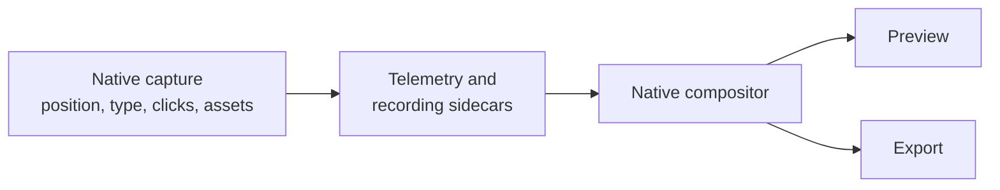

# Cursor pipeline

The cursor feature records system-cursor position and, where the native provider is available, cursor assets separately from the screen video, then re-renders the cursor as a themed, smoothed sprite instead of baking it into the capture. Its shared smoothing and asset code lives in `src/lib/cursor/`; native capture and IPC adapters live under `electron/native/` and `electron/native-bridge/cursor/`; the native compositor draws it (`crates/compositor/src/cursor.rs`).

## Capture

Native capture keeps cursor data separate from the video frame. On Windows, the WGC cursor sampler in `electron/native/wgc-capture/src/cursor-sampler.cpp` samples the system cursor during desktop duplication and records its position, hotspot, bitmap, and cursor type. On macOS, the ScreenCaptureKit cursor helper at `electron/native/screencapturekit/Sources/OpenScreenMacOSCursorHelper/main.swift` samples the current system cursor, emits unique bitmap assets, and records cursor samples plus left-button interaction events. The recording sessions under `electron/native-bridge/cursor/recording/` select and wrap the platform provider; `telemetryCursorAdapter.ts` provides the position-only fallback when native assets are unavailable. The resulting contracts are `CursorRecordingData` and `CursorRecordingSample` in `src/native/contracts.ts`.

## Telemetry

Position telemetry is represented by `CursorTelemetryPoint` in `src/lib/cursorTelemetryBuffer.ts`. Each point contains `timeMs`, the offset from recording start, and `cx`/`cy`, clamped ratios of the captured surface (`cursorTelemetryBuffer.ts:1-10`). The main-process `CursorTelemetryBuffer` starts a session with a recording id, appends samples, and finalizes them into FIFO batches keyed by that id (`cursorTelemetryBuffer.ts:25-34`). This key keeps asynchronous persistence and discard operations associated with the correct recording. Native cursor samples use the same recording-time convention, and `crates/compositor/src/cursor.rs:100-123` loads a selected window by subtracting its offset so the first sample is at time zero.

## Rendering

The native compositor draws the cursor in the preview and in the export alike. There is no preview overlay: the recorded cursor is part of the composited frame, read from the same cursor sidecar the export uses. The compositor in `crates/compositor/src/cursor.rs` interpolates raw samples, applies the same 240 Hz spring-style smoothing, and computes click-bounce timing (`cursor.rs:126-196`). Preview and export therefore consume the same telemetry and cursor rules rather than maintaining independent cursor tracks.

Glass cursors read the picture under them. When the cursor is the Prism Glow crystal or Glass Lens (`CursorPlan::glass`), each backend copies the frame as composed so far, footage and privacy blurs included, just before drawing the cursor, and the shader refracts that copy. Glass Lens does this with the 3D option off as well: its sprite names a glass model (`glass` in `cursorSprites`), and mode 19 (`cursor_glass_cb`) draws that model face on instead of the PNG, which only serves the theme picker.

## Cursor overrides

A cursor override is a stretch of a take's pointer drawn again, by hand in the editor or by an agent. The recorded track, `<video>.cursor.json`, is **read-only**: nothing writes it after the recording. An override is stored in the project (`cursorOverrides`, `cursorOverrideSchema` in `src/lib/ai-edition/schema/index.ts`) and replaces the recording over its span wherever the track is read. Removing the override is what brings the recorded pointer back, so the original is never lost and the revert survives a restart.

**The model.** An override names an asset, a span in that asset's recording milliseconds (the sidecar's clock), and a list of points: where the pointer arrives, when, and whether it clicks there. It is anchored to the asset and not to a clip, unlike a zoom: it is a fact about the footage, as the pointer track itself is, so every clip cut from the take shows it and a trim or a reorder needs no reprojection. Two overrides of one asset never share an instant; an edit stops against its neighbour (`clampCursorOverrideSpan`).

**One author of the motion.** `cursorOverrideSamples` (`src/lib/ai-edition/timeline/cursor-overrides.ts`) is the only place that turns an override into pointer samples: at rest on a point, then an eased glide of at most 600 ms that arrives on the next point at that point's time, a press held 80 ms on a point that clicks. The samples are in the sidecar's own shape, so every reader of the recorded track reads them unchanged. An override with no point draws nothing: the recording is still cut out over the span, and every reader interpolates straight across it.

**Joining the recording.** A new override opens and closes on the pointer the project already draws there (`createCursorOverride`), so it meets the recording without a jump. Those two points are marked `recorded`: they follow the span's edges and are read again when an edge moves. A point the user moves becomes their own.

**Who applies it.**

| Reader | How |
| --- | --- |
| Native compositor, preview and export | The scene carries each override as ready-made samples (`cursorPatches`, `cursorPatchesForScene`). `CursorTrack::load_take` in `crates/compositor/src/cursor.rs` drops the recorded samples over each span and puts the patch's in, on the raw sample list, before positions, clicks, visibility and cursor types are derived. It generates nothing. The live preview's track cache keys on a fingerprint of the take's patches (`cursor_key` in `live.rs`), so a pointer edit rereads the track and any other edit does not. |
| Click sound, the Clicks lane | `takeClickCues` in `clickSound.ts` builds the cues from the recorded track with the overrides applied. |
| Zoom planner (the wand, `addAutoZooms`, a fresh take) | `collectAutoZoomSuggestionsForDocument` applies the overrides to each take before planning. |
| Agent tools (`getCursorTrack`, a zoom's `cursorAnchor`) | `drawnCursorLoad` in `electron/ai-edition/document-tools.ts`. |

A take with no cursor file (recorded with the system cursor, or captured by a script) is an empty recording to all of them, and its track is then the overrides alone. That is how `setPointerTrack` gives a script-driven take its pointer: one override over the whole video ([mcp-server.md](mcp-server.md#the-media-tools)).

**In the editor.** Overrides are pills on the timeline's Cursor lane (`P` adds one at the playhead, where the take has a pointer to draw again). Selecting one shows its path on the preview with a handle per point (`CursorPathOverlay.tsx`): a press on the picture places a point at the playhead, a drag moves one, a double-click removes it. When the pointer arrives is the point's tick on the pill. While an override is selected and the preview is paused, the picture is shown without zooms or the cursor-following fill (`flatPictureDocument`), because both move the footage under the handles; playing shows the real film. A scrub on the ruler keeps the override selected, since placing a point is "put the playhead here, then press on the picture". The inspector hides the pointer over the span, sets a click per point, and restores the recorded cursor by removing the override.

The cursor's shape over an override is the arrow: an override carries no cursor type, and the recording's own resumes with its next sample.

## Settings

The cursor settings pane is `CursorPane` in `src/components/ai-edition/RightPanes.tsx`; the current v4 inspector exposes it through the cursor facet in `src/components/ai-edition/v4/FloatingInspector.tsx:57-63,1073`. It controls showing the cursor, clipping it to the canvas, theme, size, smoothing, motion blur, and click bounce. `RightPanes.tsx:1592-1692` binds those controls to editor settings and forwards the rendering parameters to the native compositor. Preview and export both render through that compositor, so a change shows in both.

## Auto-follow

Cursor telemetry also drives camera focus for auto-follow zooms. `src/lib/zoomMath/cursorFollowUtils.ts` interpolates the cursor at content time and applies distance-adaptive, frame-rate-independent smoothing. The zoom-region utilities use that focus for preview, while the export frame renderer uses the corresponding focus during export. The native compositor keeps a raw track for cursor placement and derives a separately smoothed follow track (`crates/compositor/src/cursor.rs:16-24,126-136`), preventing camera motion from changing the cursor's actual recorded position.

## Bundled assets

No themed cursor pack ships today. The packs that used to sit under `public/cursors/<id>/` came from sweezy-cursors.com, whose terms forbid redistributing them, and were removed. A pack added later goes there as arrow and pointer PNGs registered in `CURSOR_THEMES` (`src/lib/cursor/cursorThemes.ts`), under a licence that allows redistributing them; the editor only shows the theme picker once one exists. The built-in native replacement SVG set is under `src/assets/cursors/`; `DEFAULT_CURSOR_SPRITES` in `src/lib/cursor/cursorThemes.ts` maps each captured cursor type to its rasterized asset and hotspot.

The same built-in art also exists as PNGs under `public/cursors/default/`, generated from those SVGs by `scripts/generate-default-cursor-sprites.mjs`. The native compositor decodes png/jpeg from a real path and cannot read the SVGs, which exist only as bundler URLs in the renderer — so without the PNG set it had no default art and drew a placeholder dot-and-ring instead of a pointer. Regenerate rather than hand-editing: the script also emits the `DEFAULT_CURSOR_SPRITES` hotspot table, which would otherwise drift from the images.

## Sprite selection and the hotspot

`resolveCursorSprites` (`cursorThemes.ts`) resolves one sprite per `NativeCursorType`: the selected theme's art where it has any, the built-in art everywhere else. A pack may ship only an arrow and a pointer while a recording walks through a dozen OS states, so this fallback is what keeps a text caret from rendering as an arrow. `resolveSceneAssetPaths` (`compositorViewService.ts`) turns that table into absolute on-disk paths and puts it in the scene as `cursor.cursorSprites`; the compositor picks by the state in the track and falls back to the arrow.

Each sprite carries its hotspot as a **fraction of its own image**, not in pixels. The compositor scales the sprite to the cursor-size setting, so a pixel offset would need rescaling at draw time; a fraction survives any scale. Both renderers anchor on it (`cursor_sprite_dst` in `compositor.rs`, and `renderAsset.hotspot* × scale` in the web paths) — drawing from the sprite's centre instead made an enlarged cursor point further and further from its target.

## Known gaps

macOS single-window capture can report a cursor offset relative to the captured surface. This remains an open platform-specific alignment issue; display capture does not exhibit the same verified gap.
